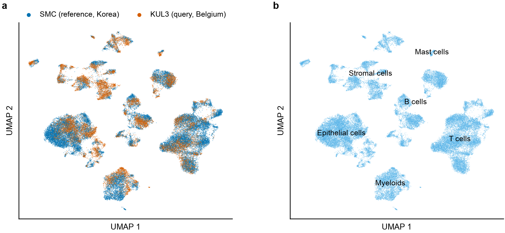

# crc-singlecell-reference-mapping

[](https://github.com/MMatinGerami/crc-singlecell-reference-mapping/actions/workflows/ci.yml)
[](LICENSE)
[](https://github.com/MMatinGerami/crc-singlecell-reference-mapping/releases)
<!-- add the Zenodo DOI badge once the repo is archived (see notes) -->

How well do cell-type labels transfer from one colorectal cancer scRNA-seq cohort to another, and
can we flag cells whose type is missing from the reference?

**In one line:** scANVI with scArches reaches macro-F1 0.75 over 33 fine subtypes when a Korean
reference (23 patients, about 63k cells) annotates a Belgian query (6 patients, about 27k cells);
logistic regression on PCA gets 0.74 without any batch correction; a missing lineage is easy to
flag (AUROC 0.99) but a missing subtype with a close relative is absorbed by it.

Reference: SMC cohort. Query: KUL3 cohort. Both from
[Lee et al., 2020](https://doi.org/10.1038/s41588-020-0636-z). A second query,
[Pelka et al., 2021](https://doi.org/10.1016/j.cell.2021.08.003), tests a change of hospital.
Query labels are only used for scoring.

<p align="center"></p>

*The two cohorts mix after scANVI mapping while cell types stay separate. UMAP of the scANVI
latent space for 40,000 of the 88,922 cells. Left: by cohort. Right: major cell types.*

## Results at a glance

| Question | Answer |
|---|---|
| Do major lineages transfer? | Yes: macro-F1 0.995 to 0.997 over 6 lineages, all four methods |
| Do fine subtypes transfer? | Partly: macro-F1 0.754 (scANVI, 95% CI 0.71 to 0.75) and 0.742 (logistic regression) over 33 shared subtypes |
| Where does it fail? | Discrete types transfer (mast cells, enteric glia, F1 about 1.0); continuous states do not (proliferating myeloid 0.15, tumour CMS subtypes 0.0 to 0.71) |
| Can abstention help? | Rejecting the 20% least-confident calls raises accuracy on the rest from 0.82 to 0.89 |
| Can we flag a missing cell type? | A deleted lineage with no close relative: AUROC 0.99 by latent distance. A deleted subtype with a close relative: 96% of tip-like endothelial cells were called stalk-like |
| Do conformal sets survive the cohort shift? | 86.4% coverage at a 90% target; density-ratio weighting does not recover it (86.7%) |
| Does a multi-hospital reference help? | On Pelka, a reference from both hospitals raises macro-F1 on the smaller hospital from 0.82 to 0.92 and restores 90% coverage |
| Is the confidence calibrated? | scANVI is over-confident (ECE 0.125); one temperature fitted on reference patients halves it (0.063) and transfers across cohorts |

Methods compared: logistic regression and kNN on PCA (no batch correction), scVI + kNN, and
scANVI. The query is mapped into scVI and scANVI with scArches, keeping the reference weights
frozen. Every analysis (calibration, conformal sets, reference size, doublets, scib-metrics) is in
[docs/results.md](docs/results.md); the model is described in [MODEL_CARD.md](MODEL_CARD.md).

## Quickstart

```bash
uv sync
make data     # both cohorts from GEO, about 190 MB
make all      # every analysis and figure (main experiment under an hour on an M-series Mac; the open-set retrainings a few hours)
make test
```

Annotate your own colorectal cancer query with the trained reference (after `make all`):

```bash
uv run scmap annotate query.h5ad --target 0.95 -o labels.csv   # raw counts in .h5ad; abstains below the confidence needed for 95% accuracy
```

## When to use this

- You annotate colorectal cancer scRNA-seq against a published reference and want to know what
  accuracy to expect per subtype, per patient and per tissue region before you trust the labels.
- You need a worked, tested example of scArches mapping with abstention, novelty scores and
  conformal prediction sets under cohort shift, on public data that downloads in minutes.
- You want the baseline numbers for a fair comparison: logistic regression on PCA is within
  0.012 macro-F1 of scANVI here.

Not a general annotation tool (use CellTypist, scANVI or popV for that) and not tuned for
other tissues.

## Limitations

- One tissue, one platform, and only six query patients, so intervals are wide.
- "Novel" means absent from the reference annotation, not from the tissue.
- Fine labels such as CMS subtypes cut through continuous biology, so some errors are
  disagreements about boundaries.

## Citation

```bibtex
@software{gerami2026crcmapping,
  author  = {Gerami, Matin},
  title   = {Cross-cohort cell-type annotation in colorectal cancer scRNA-seq},
  year    = {2026},
  version = {0.5.0},
  url     = {https://github.com/MMatinGerami/crc-singlecell-reference-mapping}
}
```

## References

Lee et al., Nat Genet 2020 (GSE132465, GSE144735); Pelka et al., Cell 2021 (GSE178341);
scVI ([Lopez et al., 2018](https://doi.org/10.1038/s41592-018-0229-2)), scANVI
([Xu et al., 2021](https://doi.org/10.15252/msb.20209620)), scArches
([Lotfollahi et al., 2022](https://doi.org/10.1038/s41587-021-01001-7)).

## License

MIT
